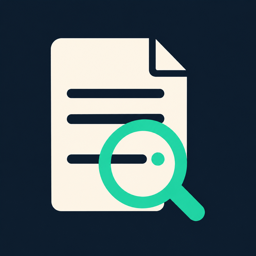

<p align="center">
  
</p>

<h1 align="center">Research Compass</h1>

<p align="center">
  학술 문헌을 바탕으로 연구 주제의 차별성과 실행 가능성을 검토하는 Codex 플러그인입니다.<br>
  근거 위치를 기록하고, 데이터·기간·연산 조건에 맞춰 최소 실험과 투고처를 제안합니다.
</p>

<p align="center">
  <a href="#설치">설치</a> · <a href="#사용법">사용법</a> · <a href="#결과-파일">결과 파일</a> · <a href="README.md">English</a> · v1.0.1
</p>

---

## 설치

로컬 플러그인을 지원하는 Codex와 Python 3.10 이상이 필요합니다. `scripts/`를 포함한 저장소 전체를 내려받은 뒤, `plugin.json`이 있는 루트에서 실행합니다.

```sh
mkdir -p .agents/plugins
cp -n marketplace.example.json .agents/plugins/marketplace.json
codex plugin marketplace add .
codex plugin add research-compass@research-tools
```

기존 `.agents/plugins/marketplace.json`을 사용 중이면 예제의 플러그인 항목을 기존 `plugins` 배열에 추가합니다. Codex 앱에서는 설치 후 새 채팅을 열어 사용합니다.

## 사용법

관심 주제만으로 시작할 수 있습니다. 데이터 접근 조건, 연구 기간, 장비, 관심 저널·학술대회를 함께 입력하면 제안 범위를 좁힐 수 있습니다.

```text
$research-compass:research-compass

의료 영상 AI의 사전학습 연구 주제를 탐색해 주세요.
공개 데이터, 연구 기간 2개월, RTX 4070 SUPER 1대 조건입니다.
후보별 선행 연구와의 차이와 첫 주 검증 실험을 비교해 주세요.
주제에 맞는 저널·학술대회의 공식 이름과 적합성 근거를 제시하고 결과를 별도 폴더에 저장해 주세요.
```

문헌 전문과 투고처 정보 확인에는 Codex에서 원문과 공식 페이지에 접근할 수 있어야 합니다. 접근하지 못한 정보는 미확인으로 표시합니다.

## 결과 파일

| 파일 | 내용 |
| --- | --- |
| `report.md` | 후보 비교, 연구 계획, 투고 전략 |
| `evidence-cards.md` | 주장별 원문 위치, 문헌 버전, 발췌 |
| `first-week.md` | 첫 주 검증 체크리스트 |
| `references.bib`, `references.ris` | 참고문헌 내보내기 |
| `state.json` | 연구 조건, 검색 이력, 진행 상태 |

이어서 작업하려면 같은 스킬을 호출하고 `state.json` 경로와 변경할 조건을 전달하세요. GitHub에 직접 업로드할 때는 개인 연구 결과가 담긴 `runs/`를 제외하세요.

파일럿 측정, 검색 예산, 투고처 재확인과 최종 보고서 검증은 [실행 절차](skills/research-compass/references/workflow.md)에, CLI 사용법과 저장 형식은 [데이터 계약](skills/research-compass/references/data-contract.md)에 있습니다.

1.0.1에서는 초기 선별 후 상세 검토, 근거와 연결된 후보 요약, 후보별 진행 상태를 추가했습니다. 문제와 연구 질문에서 의미 있는 효과·독립 표본·측정 기반 자원·시간대와 원고 준비 기간을 반영한 투고 마감까지 연결합니다.

10개 개선 항목의 완료·검증 기록은 [개선 실행 계획](docs/IMPROVEMENT_PLAN.md)에 있습니다. [오프라인 비교](docs/benchmarks/rc07-review-depth.json)는 합성 입력을 사용하며 실제 문헌 탐색 품질이나 LLM 비용을 측정한 결과가 아닙니다.

## 라이선스

Research Compass는 [MIT 라이선스](LICENSE)로 배포합니다.
