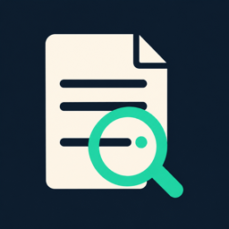

<p align="center">
  
</p>

<h1 align="center">Research Compass</h1>

<p align="center">
  A Codex plugin for evaluating the novelty and feasibility of research ideas against the literature.<br>
  It records source locations and proposes pilot experiments and venues based on your data, timeline, and compute.
</p>

<p align="center">
  <a href="#installation">Installation</a> · <a href="#usage">Usage</a> · <a href="#output-files">Output files</a> · <a href="README.ko.md">한국어</a> · v1.0.1
</p>

---

## Installation

You need a Codex environment that supports local plugins and Python 3.10 or later. Download the full repository, including `scripts/`, and run these commands from the root containing `plugin.json`.

```sh
mkdir -p .agents/plugins
cp -n marketplace.example.json .agents/plugins/marketplace.json
codex plugin marketplace add .
codex plugin add research-compass@research-tools
```

If you already use `.agents/plugins/marketplace.json`, add the example plugin entry to its `plugins` array. After installation, start a new chat in the Codex app.

## Usage

A topic is enough to start. Include data access, research duration, hardware, or preferred journals and conferences to narrow the recommendations.

```text
$research-compass:research-compass

Explore pre-training research topics in medical imaging AI.
I have public datasets, two months, and one RTX 4070 SUPER GPU.
Compare each candidate with prior work and propose a first-week pilot.
Name the journals and conferences that fit, explain why, and save the results in a session folder.
```

Full-text review and venue verification require access to the source papers and official pages. Unavailable information is marked as unverified.

## Output files

| File | Contents |
| --- | --- |
| `report.md` | Candidate comparison, research plans, and submission strategy |
| `evidence-cards.md` | Source locations, paper versions, and excerpts for claims |
| `first-week.md` | First-week validation checklist |
| `references.bib`, `references.ris` | Bibliography exports |
| `state.json` | Research constraints, search history, and progress |

To resume, invoke the skill with the path to `state.json` and describe the changes you want. If you upload files directly to GitHub, exclude `runs/`, which contains private research results.

The [workflow guide](skills/research-compass/references/workflow.md) covers pilot measurements, search budgets, venue rechecks, and final report validation. The [data contract](skills/research-compass/references/data-contract.md) covers CLI usage and file formats. Both guides are in Korean.

Version 1.0.1 adds screening before detailed review, a candidate summary with source links, and candidate-specific progress tracking. Plans connect the problem and research question to meaningful effects, independent samples, measured resources, and submission deadlines with time zones and writing time.

All ten improvements and their checks are recorded in the [improvement plan](docs/IMPROVEMENT_PLAN.md), in Korean. The [offline comparison](docs/benchmarks/rc07-review-depth.json) uses synthetic inputs; it does not measure real literature-search quality or LLM costs.

## License

Research Compass is released under the [MIT License](LICENSE).
